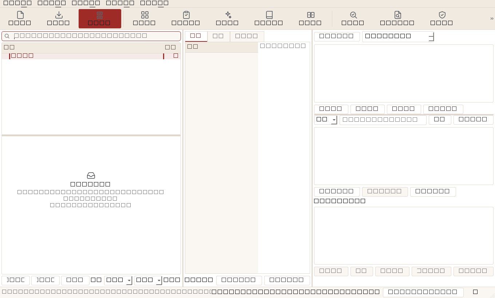

# v1.9 只读审计 · 05 数据层 / 数据库运维 / 备份恢复 / 安全日志 / UI 交互

> 审计对象：`<仓库根>` 公文汇编助手 **v1.8.0**（`gwtool/__init__.py:7`）
> 审计方式：**只读源码 + 独立探针实测**，未修改任何源码；未跑全量 pytest / e2e / 打包；零网络。
> 环境：`.\.venv\Scripts\python.exe`（Python **3.13.14**）、`PYTHONIOENCODING=utf-8`、
> `QT_QPA_PLATFORM=offscreen`（UI 走查）+ 原生 windows 平台（DPI/尺寸补测）。
> 数据全部隔离在 `%TEMP%\gwaudit05_*`，**未触碰 `%APPDATA%\gwtool` 真实库**。
> 探针脚本放临时目录、跑完即删（与兄弟审计一致）；关键截图保留在
> `doc/_audit_v19/screens/05_*.png`。
> 下文所有"实测"均可用给出的命令/探针片段在本机复跑；**未实测项一律标注"待验证"**。

---

## 1. 功能清单与入口

### 1.1 数据层

| 能力 | 实现/入口 | 关键实现与事实 |
|---|---|---|
| 建库/迁移 | `db/schema.py::init_schema` | `SCHEMA_VERSION=7`（`:46`）；16 张业务表（`:69-297`）+ 4 张 FTS5 虚表（`:339-354`）+ **18 个显式索引**（`:302-328`，其中 2 个 UNIQUE、16 个普通索引。任务描述里的"16 索引"仅指普通索引） |
| 迁移链 | `MIGRATIONS`（`:58-67`） | v2 simhash、v3 软删除；v4/v5/v6/v7 只由 `TABLES` 补新表、`MIGRATIONS` 留空；整段 DDL 单事务 + 仅成功后写 `user_version`（`:427-500`） |
| 连接管理 | `db/connection.py::get_conn` | thread-local 连接；`timeout=30`（`:97`，即 `busy_timeout=30000`）、`journal_mode=WAL`（`:99`）、`synchronous=NORMAL`（`:100`）；进程内 `_INIT_LOCK` 串行化初始化（`:39`/`:95`） |
| 迁移/新版库自动留档 | `_pre_migrate_backup`（`:117-179`） | 打开前用 SQLite 在线备份 API 落自洽快照，命名 `*_premigrate_v{n}.zip` / `*_newer_v{n}.zip` |
| DAO | `db/dao.py`（1 922 行 / 112 函数） | 全部参数化 SQL（f-string 只拼列名/表名白名单）；FTS 在 DAO 内同步维护；段落索引为派生数据 |
| 全文检索 | `dao.py::rebuild_fts`（`:591`）、`_fts_search`（`:1154`） | 增量重建（`fts_index_state` 比对内容哈希）；FTS 异常返回 `[]` 不抛 |
| 段落索引 | `dao.py::rebuild_paragraphs`（`:1706`）、`replace_paragraphs`（`:1646`） | `paragraphs.text` **整段复制** `documents.content_text`（`:1672`），每段再写一份 jieba 分词进 `paragraphs_fts`（`:1680`） |
| 台账/附件/快照/模板 | `dispatch_register`、`receive_register`、`attachments`、`snapshots`、`templates` | 索引：`idx_attachments_doc`、`idx_snapshots_doc`、台账 4+3 个（`schema.py:315-323`） |

### 1.2 备份 / 恢复 / 移交

| 能力 | 入口 | 事实 |
|---|---|---|
| 手动/自动备份 | `core/backup.py::create_backup_detailed`（`:204`） | 在线备份快照（`:172`）→ zip（可 AES）→ `.part` 原子改名 → 轮转保留 20 份（`:492`） |
| 附件上限与"不静默丢" | `_plan_attachments`（`:293`）、manifest + `excluded_attachments.txt`（`:366-425`） | 手动默认 30 MB、自动 8 MB；超限逐条记录原因 |
| 加密备份 | `create_backup_detailed(password=...)` | 依赖可选 `pyzipper`（WZ_AES）；`ENCRYPTED` 明文条目标记（`:70`） |
| 恢复 | `restore_backup_detailed`（`:610`） | 先做恢复前自动备份 → 占用线程检查（`:663`）→ 解包 `.restore.tmp` → 三层校验（`:780`）→ 内容缩水守卫（`:583`）→ `os.replace` 重试（`:735`）→ 清旧 `-wal/-shm` → 模板/附件还原，缺失清单 `_missing_attachments`（`:838`） |
| 移交包 | `core/exporter.py::build`（`:132`）、`verify_package`（`:275`） | manifest 记录 sha256；支持原始文件优先/文本退化；校验可回读 |

### 1.3 安全 / 日志 / 运维

| 能力 | 入口 | 事实 |
|---|---|---|
| 口令锁 | `core/security.py` | PBKDF2-HMAC-SHA256、**120 000 次**（`:14`）；`iterations$salt$hash`；`hmac.compare_digest`（`:42`）；启动锁流程 `app.py:_pass_lock`（`:139-154`） |
| 运行日志 | `logs.py` | Rotating：2 MB × 5（`:32-33`）；队列异步写；`RedactingFilter`：带参日志参数 >64 字压成长度标记（`:56`），无参长消息 >512 字整体替换（`:58`/`:95-109`） |
| 崩溃日志 | `_crash_summary`（`:202-221`） | 只记"异常类型 + 长度 + 最末帧位置" |
| 诊断包 | `core/diagpack.py` | 只含系统/依赖/能力/各表行数/日志末尾 200 KB（`:139`）；预览页明示不含正文（`:194-209`）；单测可验 |
| 健康自检 | `core/dbhealth.py` | 30 天一次 `quick_check`（`:172`）；只读交叉一致性 3 条查询（`:122-169`）；手动 `VACUUM+REINDEX+rebuild_fts`（`:196-272`，VACUUM 前按 2.2 倍库体积预检空间 `:215`） |
| 只读/无权限降级 | `paths.py::_ensure_dir`（`:31-48`）、`app.py:205-248` | 数据目录不可写→`DataDirError` + 可执行中文指引；库损坏/版本过新/迁移失败各有专门文案 |

### 1.4 UI 入口（抽样 18 个对话框 + 主窗口）

| 区域 | 入口/事实 |
|---|---|
| 主窗口 | 工具栏 14 个动作（`main_window.py:298-385`）、5 个菜单 39 项（`:492-592`）、状态栏 + 常驻角标 + `StatusBarToast`（`:387-399`/`:1499`） |
| 快捷键 | Ctrl+Shift+N / Ctrl+N / F7 / F9 / Ctrl+Shift+B / Ctrl+R / Ctrl+Shift+R / Ctrl+Shift+F7 / Ctrl+O / Ctrl+S / Ctrl+Q / F8 / F3（`main_window.py:303-343`、`:495-592`、`:630`） |
| 对话框 | AnyDocCorrectDialog、CompareDialog、CompileWizard、DictManager、ImportDialog、TemplateEditor、InspectorDialog、BulkReplaceDialog、BatchCorrectDialog、SnapshotsDialog、SimilarityDialog、SecurityDialog、LockDialog、AttachmentDialog、RecycleBinDialog、RegistryDialog、ReceiveDialog、WritingHintsDialog（18 个全部构造成功，见 §2.9） |
| 长任务 | 统一 `FnWorker`（`ui/workers.py:47`）+ `ThreadSafeDialog`（`ui/widgets.py:184-205`，closeEvent 等线程）；主窗口 `closeEvent` 最长等 10 s（`main_window.py:1557`） |
| 危险操作确认 | 备份/恢复/体检维护/诊断包/批量替换/批量纠错/回滚统一 `ask()` 二次确认（如 `main_window.py:1393`、`:995`、`:969`） |

---

## 2. 实测记录

> 命令统一在仓库根目录、`.\.venv\Scripts\python.exe` 下执行；探针用
> `paths.set_app_data_dir(temp)` + `dbconn.configure(temp/"gwtool.db")` 隔离。
> 探针已删除，文末给出可复跑代码片段。

### 2.1 种子库规模与索引分布

命令：`python <probe 05_data>`（等价片段见 §7-A）。

| 指标 | 实测值 |
|---|---|
| `ensure_database_seeded()` 耗时 | **0.87 s** |
| 主库文件 | **19.352 MB**（`user_version=7`，`journal_mode=wal`，`busy_timeout=30000 ms`，`page_size=4096`，`freelist=0`） |
| 表/索引对象 | 16 业务表 + 4 FTS5 + 20 个 FTS5 影子表 + sqlite 内部表；**显式索引 18 个** |
| `dictionary` / `error_pairs` 行数 | **123 393** / **39 504** |
| 体积 TOP（`dbstat`） | `dictionary` 10.148 MB、**`idx_dictionary_word_source` 3.562 MB**、`error_pairs` 2.270 MB、**`idx_dictionary_word` 2.211 MB**、`idx_error_pairs_key` 0.922 MB |
| `documents_fts` / `dictionary_fts` / `phrases_fts` / `paragraphs_fts` 行数 | 0 / 0 / 0 / 0（空库尚未导入文档） |

### 2.2 线索①：两个词典索引是否重复？代价多大？（**属实，但结论要修正**）

`dictionary(word)` 是 `dictionary(word, source)` 的**最左前缀**，逻辑上冗余
（`schema.py:307` / `:312`）。真实 DAO SQL 的查询计划与逐项耗时（同一份 19 MB 种子库，复制后
`DROP INDEX + VACUUM + ANALYZE`，5 000 次热查词取均值）：

| 方案 | 库体积 | 精确查词 | 按来源取词 | `SELECT DISTINCT word` | 插 2 万词 | 精确查词计划 |
|---|---|---|---|---|---|---|
| 现状（两索引） | **18.543 MB** | 6.8 µs/次 | 6.8 ms | 77.2 ms | 70.0 ms | `idx_dictionary_word` |
| 只留复合 `(word,source)` | 16.598 MB（−1.945 MB） | 7.5 µs/次 | 6.8 ms | 77.7 ms | 54.4 ms | 复合索引（word 前缀） |
| 只留 `(word)` | 15.414 MB（−3.129 MB） | 6.7 µs/次 | **26.5 ms（4×）** | 79.6 ms | 163.4 ms | `idx_dictionary_word` |
| 两索引都删 | 13.469 MB | **12 136 µs（1 785×）** | 12.6 ms | 152.7 ms | 34.4 ms | 全表 SCAN |

**结论**：
1. 冗余性能代价 = `idx_dictionary_word` 的 **1.945 MB（种子库的 10.5%）**；
   删掉它精确查词从 6.8 µs→7.5 µs（噪声量级），按来源取词不变，插入反而更快。
2. **不能删复合索引**：只留 `(word)` 时按来源查询 6.8 ms→26.5 ms（4×），
   而 `builtin_dictionary_words` / `user_dictionary_words` / 按来源启停词表都走它
   （`dao.py:741-777`、`:806-835`）。
3. 线索中"精确查词实际走复合索引"**不准确**：有简单索引时 SQLite 选更窄的
   `idx_dictionary_word`；删掉后才会用复合索引前缀（命中数不变）。
4. 最佳落点 = **只删 `idx_dictionary_word`**，保留复合索引。收益 1.95 MB / 写放大下降；
   风险极低（老备份首次打开时由 `init_schema` 重建索引，需同步删 `INDEXES` 条目并加迁移说明）。

### 2.3 线索②：`dictionary_fts` 是死表吗？（**是**）

- `git grep dictionary_fts -- gwtool/` 仅命中 `schema.py:342`（建表 DDL）；
  **DAO / core / UI 零读零写**，种子库中也是 0 行；词典检索实际走 `search_dictionary` 的
  `word = ?` / `LIKE`（`dao.py:1118-1147`）。
- 代价：当前 0 字节；随库多 1 张虚表（+5 张影子表）、1 个空索引对象，增加维护面与
  "为什么建了不用"的困惑。**无功能损失**，属清理项 P2。
- 注意：不能简单 `DROP` 后不管——老备份/外部工具可能仍引用；建议迁移里
  `DROP TABLE IF EXISTS dictionary_fts` 并保留"旧包还原后不重建该表"的兼容测试。

### 2.4 线索③：`bench_scale.py` 的"段落索引体积增量 88.9%（验收线 <40%）"复核

**是真问题，但脚本的测量口径在 300/1000 档是坏的。**

1) 原脚本输出（本机复跑 `python scripts/bench_scale.py`）：

```
 300      300      0.15     0.001      0        0.8      30      0.0
1000     1000      0.43     0.005      0       2.2      30      0.0
3000     3000      1.45     0.017      0      10.0      30     88.9
段落索引体积增量：88.9%（验收线 < 40%）
```

2) 原脚本用 `db_file.stat().st_size` 只读主文件、且显示一位小数
（`scripts/bench_scale.py:57`、`:72`、`:160-164`）：WAL 模式下 300/1000 档数据仍在
`-wal` 里，主文件≈0 → 打印 `0.0%`；3000 档恰好跨过自动 checkpoint，才显出 88.9%。
**同一份脚本在小样本上给出假阴性**。

3) 用"main+wal 合计、两侧都 `wal_checkpoint(TRUNCATE)`、dbstat 归因"重测（§7-B）：

| 文档数 | 回填耗时 | 主+WAL 前 | 主+WAL 后 | 真实增量 | 新增段落表+FTS |
|---|---|---|---|---|---|
| 300 | 0.136 s | 0.777 MB | 1.227 MB | **+57.9%** | 0.286 MB |
| 1 000 | 0.447 s | 1.918 MB | 3.438 MB | **+79.2%** | 0.903 MB |
| 3 000 | 1.329 s | 5.148 MB | 9.695 MB | **+88.3%** | 2.637 MB |

`dbstat` 归因（3000 档）：`documents=1.957 MB`，`paragraphs=1.957 MB`（**整段复制原文**），
`paragraphs_fts*≈0.47 MB`，`idx_paragraphs_doc=0.039 MB`，`fts_index_state=0.168 MB`。
即"增量 ≈ 一份原文 + 一份分词索引"，**不是统计伪影**。

4) 影响面：这是**设计使然**（`schema.py:268` + `dao.py:1672/1680`）。任何资料库（文档数越多、
   原文越多）都会近似**翻倍**：1000 篇/28 万字的库（见 §2.7 造数）文档部分从约 1.5 MB
   文本变成约 3 MB。对已含 19 MB 词典的种子库整体是 +10~15%，对纯资料库是 +58~88%。
   验收线 `<40%` 在当前设计下**不可能达成**；要么改验收口径，要么改存储（见 §4-4）。

### 2.5 交叉一致性自检：软删除后**必然误报**

`dbhealth.consistency_check` 用 `SELECT count(*) FROM documents`（**含回收站**）
对比 `documents_fts`（**不含软删除**，`dao.delete_document` 会摘 FTS 行 `dao.py:364-375`），
判据在 `dbhealth.py:138-155`。实测：

| 操作 | documents 总数 | 在库 | 回收站 | FTS 行 | consistency_check |
|---|---|---|---|---|---|
| 空库 | 0 | 0 | 0 | 0 | 无问题 |
| 建 2 篇 + 软删 1 篇 | **2** | **1** | 1 | **1** | **报"全文索引与文档数不一致（2 篇 / 1 行）"** |

复现：`python -c "... dao.add_document(...); dao.delete_document(id); print(dbhealth.consistency_check())"`。
影响：任何用户只要用过回收站，`quick_check` 仍 ok，但维护结果/诊断包会持续显示
"部分文档可能搜不到"，并建议重建索引；重建也治不好（重建同样不索引回收站文档），
属于**误导性告警**，会诱导用户做不必要的恢复操作。**P1**。

### 2.6 事务 / 锁 / 迁移 / 版本兼容

| 场景 | 探针 | 结果 |
|---|---|---|
| 另一连接持写锁时本连接写入 | `BEGIN IMMEDIATE` + `INSERT` | 等满 **32 856 ms** 后 `OperationalError: database is locked`（`busy_timeout=30 000` 生效，但 **GUI 线程会冻结 30 s**） |
| v6 老库首次打开 | 复制种子库→`PRAGMA user_version=6`→`get_conn()` | 迁移到 v7，**946.7 ms**；迁移前自动备份 `gwtool_backup_*_premigrate_v6.zip` **7.86 MB** |
| v8 新版库 | `PRAGMA user_version=8`→`get_conn()` | `SchemaTooNewError`，库原样保留；自动留档 `*_newer_v8.zip` |
| 注入面 | 标题=`x'); DROP TABLE documents;--`、分类名同串、FTS 查询含 `" OR 1=1 --` | `documents` 表存活、标题按原文存储、FTS 特殊串返回 0 不抛 → 参数化 SQL 有效 |
| 常见查询计划 | `EXPLAIN QUERY PLAN` | `list_documents` 走 `idx_documents_deleted` + **TEMP B-TREE 排序**；`count` 走覆盖索引；`list_paragraphs` 走 `idx_paragraphs_doc`；`attachment_counts` 走覆盖索引；台账搜索走 `idx_dispatch_sign_date`（3000 篇列表实测 17.8 ms，排序成本可接受） |

### 2.7 备份 / 恢复（200 篇 ≈28 万字 + 6×150 KB 附件）

造数：200 篇 × 1 404 字 = **280 800 字**（每篇唯一内容，避免 text_hash 去重）+ 6 个附件；
库 = 19.35 MB 种子 + 文档/段落/FTS（含 WAL 合计 **42.82 MB**）。

| 操作 | 耗时 | 体积 | 结果 |
|---|---|---|---|
| 手动备份（30 MB 附件预算） | **3.10 s** | **7.78 MB** | 附件 6/6 随包、manifest 可读、无排除 |
| 备份后再加 5 篇 → 恢复 | **3.03 s** | — | 文档 201→**200**、附件 6/6 还原、`quick_check=ok`、恢复后可继续写入 |
| 恢复前自动备份 | 包含在上面的 3.03 s 内 | — | `backups/` 数量 1→2 |

损坏/非法包（每次失败后核对当前库文档数）：

| 场景 | 结果 | 当前库是否变动 |
|---|---|---|
| zip 截断 50% | `BadZipFile: File is not a zip file` | 未变 |
| 缺 `gwtool.db` | `ValueError: 备份包不完整（缺少 gwtool.db）` | 未变 |
| `gwtool.db` 仅 100 字节 | `ValueError: 备份包内的数据库不完整（仅 100 字节），已中止恢复` | 未变 |
| 结构合法但 0 篇文档 | `ValueError: 备份包内没有任何文档，而当前库中有 201 篇…已中止` | 未变 |
| 缺核心业务表 | `ValueError: 缺少核心业务表 dictionary、documents、error_pairs、settings…` | 未变 |

旧版本包（v6，缺 `paragraphs`/`user_skeletons`）：恢复 **ok、legacy=True、无 warning**；
首次打开自动迁移到 v7，`paragraphs` 表被重新建出（空表，回填走后台）。
→ **向后兼容符合设计**。

**新版本包（v8）**：恢复**成功返回 ok=True**（`backup.py:780-835` 只校验核心表是否存在，
不校验 `user_version`），随后本程序打开该库时抛 `SchemaTooNewError`（已留 `*_newer_v8.zip`）。
用户视角是"恢复成功→软件打不开"；可用旧备份救回（实测 `restore_backup_detailed(旧包)` 成功，
但 warning 提示"恢复前的自动备份未能创建（SchemaTooNewError）"）。**P1**（§3）。

附件超限与加密：

| 场景 | 实测 |
|---|---|
| 附件上限设 0 MB（3×120 KB） | included 0 / excluded 3 / `truncated=True`；包内有 `excluded_attachments.txt`，manifest excluded 3 条（原因"超出备份附件体积上限"） |
| AES 加密备份（`pyzipper` 可用） | 创建成功、`is_encrypted=True`、列表识别为加密；正确口令恢复 ok **2.22 s**；错误口令 `RuntimeError`（未误判成功） |
| 轮转（25 个假包 + 1 个 `.part`） | 删除 5、剩 **20**，`.part` 保留（不会被当备份） |

### 2.8 移交包 / manifest

| 指标 | 实测 |
|---|---|
| 200 篇 + 6 附件导出 | **0.07 s / 0.10 MB**（无原始文件 → 退化为 UTF-8 txt；压缩后小） |
| manifest | `version="1.0.0"`（**硬编码，与程序 v1.8.0 无关**，`exporter.py:220`）、documents 200 条、attachments 6 included / 0 excluded |
| `verify_package` 原包 | `ok=True`，problems 0 |
| 篡改 10 字节后校验 | `ok=False`，正确报 `文档内容校验失败：documents/审计材料000.txt（sha256 与 manifest 不符）` |
| 附件规划 N+1 | `exporter._plan_attachments` 逐篇 `dao.list_attachments(did)`（`exporter.py:96-97`）→ 3000 篇 = 3000 次查询；本次 200 篇仅 0.07 s，属**低优先**优化 |

### 2.9 安全 / 日志 / 诊断包 / 健康维护 / 只读降级

| 项 | 实测 |
|---|---|
| PBKDF2 | 设置 **78.9 ms**、正确校验 **79.1 ms**、错误校验 **78.0 ms**；迭代 120 000，salt 32 hex、hash 64 hex；篡改存储串 `verify=False` 不抛 |
| 口令锁流程 | 未启用/未设口令直接放行；启用+有口令才弹 `LockDialog`（`app.py:139-154`）；**注意：`verify_password` 在无存储值时返回 True（fail-open）**，属"防误用级"设计，但删 settings 行即可绕过 |
| 日志基础 | 文件存在、817 B、4 行；短参数原样保留；280 字参数→`<240 字，内容已隐去>`；崩溃摘要 `ValueError（<200 字，内容已隐去>）@ …` 不含正文 |
| **日志隐私缺口** | **f-string 拼进 `record.msg` 的 65–511 字正文不会被过滤**：实测 `log.info("f-string 长正文：" + marker(240 字))` 原样落盘；只有 >512 字才整体替换（`logs.py:58`/`:95-109`）。当前 grep 无 f-string 日志调用点，属**护栏缺口**，但一旦有人用 f-string 拼正文即泄漏 |
| 诊断包 | 2 个条目（`诊断报告.txt`、`运行日志.txt`）；含各表行数与数据目录**路径**；**不含**文档正文/附件内容；但会把日志原文带上——上述 f-string 缺口 + `log_tail` 只对 >200 字行脱敏（`diagpack.py:163-171`），**150 字以内的正文片段会原样进诊断包**（实测 20 字片段进入包内） |
| `quick_check` | 种子库 + 文档：`(True, "ok")` |
| 交叉一致性 | 见 §2.5（软删除后误报） |
| `maintenance()` | 39 MB（含 WAL）库 **3.82 s** 完成；before 38.9 MB → after **18.6 MB**（saved 20.3 MB，主要来自 WAL checkpoint+碎片回收）；`fts_rows=2`；**一致性误报仍在**（维护无法消除） |
| 只读数据库文件 | `get_conn()` 能**打开成功**（`init_schema` 幂等短路，不写）；随后 `dao.add_document` / `dao.set_setting` 均抛 `OperationalError: attempt to write a readonly database`。启动路径的 `DatabaseError` 分支只覆盖初始打开（`app.py:205-219`），运行期失败由各功能自身处理 |
| 只读/非法数据目录 | 指向"文件当目录"→`DataDirError: 数据目录不可用…（无法创建目录：[WinError 183]）`，符合可执行中文指引 |

### 2.10 UI 走查（18 个对话框 + 主窗口，100% / 150% DPI）

> 截图（离屏渲染，真实控件树）：
> 
> `screens/05_main_window.png`（1360×820）、`screens/05_AnyDocCorrectDialog.png`（1058×620）、
> `screens/05_InspectorDialog.png`（535×620）。

主窗口（1360×820 截图态）：

| 项 | 实测 |
|---|---|
| 构造耗时 | 0.30 s（含种子库） |
| 菜单 | 文件/工具/模板/设置/帮助 5 个，**39 个菜单项全部有 tooltip**（39/39） |
| 工具栏 | 14 个动作，**14/14 有 tooltip**；主色实底"一键汇编" |
| 快捷键 | Ctrl+Shift+N、Ctrl+N、Ctrl+O、Ctrl+S、Ctrl+Q、F7、F8、F9、F3、Ctrl+R、Ctrl+Shift+R、Ctrl+Shift+F7、Ctrl+Shift+B；**无重复绑定**（两个 `Esc` 来自 QLineEdit 内建清除动作，不冲突） |
| 状态栏 | 常驻权限标签 + `StatusBarToast`（4 s 自清）+ 3 个按钮；瞬态消息走 `showMessage` |
| 窗口尺寸 | 代码声明最小 1024×640（`_fit_to_screen`，`:49`，且离屏 800×800 时会被夹到 760）；但**布局实际需要宽 ≥1424（原生 150% 的 `MainWindow.minimumSizeHint()`）/ 1440（100% 下三栏 minHint 之和 586+352+502）**。1024×640 实测 splitter `[339, 340, 339]` → 左栏被压到需求值的 58%、右栏 68%，内容被裁/出现滚动 |
| 工具栏溢出 | 1024 宽时工具栏所需 1738 px > 可用宽，靠 Qt 扩展按钮收纳（可用但主操作不可见） |

对话框抽样（全部构造成功、焦点均落在对话框内；"最小尺寸 hint / 默认开窗"为 **offscreen 100%** 实测，
原生 150% 因字体度量不同另有标注）：

| 对话框 | 最小尺寸 hint | 默认开窗 | 默认焦点 | 默认按钮（autoDefault） | 备注 |
|---|---|---|---|---|---|
| AnyDocCorrectDialog | **1058×282**（原生 150% 为 828×306） | **1080×720** | 选择文件… | **选择文件…** | 默认高 720 > 640 屏；回车先弹文件选择而非"开始纠错"（`correct_dialog.py:42`） |
| CompareDialog | 342×202 | 960×640 | QComboBox | 选择文件… | 640 高 + 标题栏 > 640 屏；后台 diff 无取消（`compare_dialog.py:87-117`） |
| CompileWizard | −1×−1 | 760×560 | QComboBox | **`Next >`** | **向导按钮英文** `< Back` / `Next >` / `Commit` / `Finish` / `Cancel`（全仓无 `QTranslator`） |
| DictManager | 1000×222 | 900×600 | QTabBar | 无（无默认） | 4 页签；无后台线程 |
| ImportDialog | 822×221 | 560×420 | _DropListWidget | 添加文件… | 有"取消导入"；失败复位已有回归测试 |
| TemplateEditor | **796×645** | 1000×640 | QListWidget | 新建模板 | 高 645 > 640，底部会被标题栏裁切（`template_editor.py:25`） |
| InspectorDialog | 418×185 | 720×520 | 体检当前文档 | **浏览…** | 选"体检当前文档"后回车却弹文件选择 |
| BulkReplaceDialog | 207×269 | 680×480 | QLineEdit | 预览命中 | 正常 |
| BatchCorrectDialog | 519×225 | 840×560 | QComboBox | 预览命中 | 正常 |
| SnapshotsDialog | 332×121 | 900×560 | QListWidget | 回滚到此版本 | 危险操作有确认 |
| SimilarityDialog | 326×151 | 680×480 | QSpinBox | 开始查重 | 正常 |
| SecurityDialog | 62×97（滚动区） | **640×720** | QScrollArea | 设置/修改口令 | 默认高 720 > 640 屏 |
| LockDialog | 326×144 | 360×150 | QLineEdit | 解锁 | 无父窗口 + 置顶抢焦点（`app.py:147-153`） |
| AttachmentDialog | 656×185 | 760×420 | QTableWidget | 添加附件… | 正常 |
| RecycleBinDialog | 435×185 | 860×480 | QTableWidget | 恢复 | 正常 |
| RegistryDialog | 763×214 | **1020×620** | QTabBar | 重置 | 宽度贴近 1024 边界 |
| ReceiveDialog | 681×235 | **1120×680** | QTabBar | 查询 | 默认宽/高均超 1024×640（`receive_dialog.py:280`） |
| WritingHintsDialog | 621×249 | 760×660 | QComboBox | 生成写作提示 | 默认高 660 > 640 屏 |

主题对比度（WCAG；普通正文要求 ≥4.5，大字号/非文本 ≥3）：

| 组合 | 浅色 | 深色 | 判定 |
|---|---|---|---|
| 正文 TEXT / BG | 12.63 | 14.18 | 通过 |
| 次要 MUTED / BG | 4.61 | 6.49 | 浅色勉强通过 |
| 次要 MUTED / SURFACE（状态栏/页签） | **4.31** | 5.63 | 浅色 <4.5 |
| 错误 DANGER / DANGER_BG | 6.08 | 4.77 | 通过 |
| 警告 WARN / WARN_BG | **3.71** | 5.81 | 浅色 <4.5 |
| 成功 SUCCESS / SUCCESS_BG | **4.44** | 6.45 | 浅色临界 |
| 主色 PRIMARY / BG | 7.43 | **3.87** | 深色 <4.5（分组标题/选中页签） |
| 选中行前景 / 选中底色 | 8.73 | **1.67** | **深色几乎不可读**（`theme.py:31` SELECTED_BG 与 `:11` PRIMARY_DIM 不配对） |
| 禁用文字 / SURFACE | 2.37 | 2.52 | 禁用态可豁免，但偏低 |

### 2.11 静态交互盘点

| 指标 | 结果 |
|---|---|
| `setTabOrder` | **全仓 0 处** → Tab 顺序完全按控件创建顺序；本次抽样未发现坏顺序，但无显式设计 |
| 后台线程对话框 | correct_dialog（6 处 worker）、compile_wizard、compare_dialog、import_dialog、feature_dialogs、material_dialogs 均继承 `ThreadSafeDialog`；无取消入口的对话框：compare_dialog、correct_dialog（单次长调用无检查点） |
| 硬编码窗口尺寸 >1024×640 | `correct_dialog.py:42` 1080×720、`receive_dialog.py:280` 1120×680（其余均 ≤1000×640） |
| `except: pass` | ui/ 共 31 处（含 Qt 事件/关闭路径的合理吞错），main_window 16 处；未见阻断主流程的静默失败 |
| 长任务反馈 | 主窗口/对话框均写状态栏或 `lbl_stat`；后台任务失败多数同时写日志；`warn()` 32 处、`info()` 18 处、`ask()` 11 处（feature_dialogs） |

---

## 3. 缺陷与风险（P0 / P1 / P2）

> 定级口径：**P0** = 数据丢失/泄漏或不可用；**P1** = 明确误导、功能承诺不成立、隐私红线护栏缺口；
> **P2** = 体验/维护性/性能优化。本轮**未发现 P0**。

### P1（5 条）

**P1-1 恢复"更新版本备份"会成功，随后本程序打不开数据库**
- 现象：v8 备份包恢复返回 ok，重启/继续操作时 `SchemaTooNewError`，界面进入"数据库由更新版本创建"的拒绝分支；用户没有"恢复失败"的直接感知。
- 证据：`backup.py:780-835` 只校验核心表与 `integrity_check`，**不校验 `PRAGMA user_version`**；实测 v8 包 `restore_ok=True` → `open_after=SchemaTooNewError`，并生成 `*_newer_v8.zip`；救回需再次恢复旧包（实测成功，但 warning "恢复前的自动备份未能创建"）。
- 影响面：跨版本协作/误拿同事新版备份 → 用户被锁在程序外（数据未丢，但需手动处置）。恢复是灾难场景，**"看起来成功"最危险**。
- 复现：造 v8 库（`PRAGMA user_version=8`）压成 zip → `backup.restore_backup_detailed()` → `dbconn.get_conn()`。

**P1-2 深色主题选中行前景/底色对比度 1.67:1，文字几乎不可见**
- 现象：深色模式下列表/表格/树的选中行文字（`PRIMARY_DIM #8F2F2A`）落在 `SELECTED_BG #3D2A27` 上，实测对比度 **1.67**（WCAG 需 ≥4.5）。
- 证据：`theme.py:11`/`:31`/`:57-80`、QSS `theme.py:225-233`；探针按 WCAG 公式计算。
- 影响面：深色模式（跟随系统）下所有列表/表格选择态可读性；用户难以确认"选中了哪篇/哪行"。
- 复现：`theme.set_dark(True)` 后对 `PRIMARY_DIM` / `SELECTED_BG` 算对比度。

**P1-3 1024×640 目标分辨率未被真实支持（150% DPI 下更差）**
- 现象：主窗口声明最小 1024×640（`main_window.py:49`），但三栏布局需求 1440 宽（586+352+502）、原生 150% 下 `MainWindow.minimumSizeHint()=1424×580`；多个对话框的**默认开窗直接超过 1024×640**：AnyDoc 1080×720、Receive 1120×680、Security 640×720、WritingHints 760×660、Compare 960×640，且没有任何"按屏幕可用区夹取"的逻辑；原生 150% 屏可用区 1280×693 时 AnyDoc 高 720、Receive 高 680 均超出。
- 证据：探针 `minimumSizeHint()`/`size_before_show`（§2.10 表）；`correct_dialog.py:42`、`receive_dialog.py:280`、`template_editor.py:25`；主窗口三栏 `main_window.py:277-296`；`_fit_to_screen` 只作用于主窗口（`:39-63`）。
- 影响面：1366×768/1024×640 办公本 + 150% 缩放是目标环境；现在开窗即超屏、底部按钮/状态行被裁，用户不一定知道窗口可拖动缩放。
- 复现：`QApplication` + `MainWindow()` 打印 `minimumSizeHint()`；`AnyDocCorrectDialog()` 打印 `width()/height()`；`QT_SCALE_FACTOR=1.5` 复跑。

**P1-4 数据库维护的交叉一致性自检对"回收站"必然误报**
- 见 §2.5。任何软删除后 `documents`（含回收站）≠ `documents_fts`（不含），维护/诊断包持续告警且重建索引无法消除，误导用户以为"数据坏了"。
- 证据：`dbhealth.py:138-155`；实测 2 篇（1 篇在回收站）→ 报"2 篇 / 1 行"。
- 复现：`add_document` → `delete_document` → `dbhealth.consistency_check()`。

**P1-5 日志隐私护栏只拦 >512 字 f-string：<512 字的正文会落盘并进入诊断包**
- 现象：`logs.RedactingFilter` 对带参日志参数 >64 字脱敏，但无参 `msg` 阈值是 512（`logs.py:56-58`、`:95-109`）——**f-string 拼出的任何 <512 字正文（实测 20 字、240 字两档均泄漏）原样写入日志**；`diagpack.log_tail` 只对 >200 字行脱敏（`diagpack.py:163-171`），<200 字的正文片段随之进入诊断包（实测 20 字片段在包内）。
- 当前状态：全仓 `grep` 无 f-string 日志调用点（现网暂无实际泄漏路径），但这是"绝不记录公文正文"红线的**最后一道护栏有缺口**；异常消息字符串是主要风险入口（本项目历史上出现过 `ValueError: 无法识别的金额：'正文片段'`）。
- 复现：`logs.setup(); log.info("x"+marker)`（marker 240 字）→ 读日志文件；再 `diagpack.build()` 搜 zip。

### P2（8 条）

**P2-1 `idx_dictionary_word` 与 `(word,source)` 冗余**
- 证据/数据见 §2.2：删简单索引省 1.945 MB（10.5%），精确查词 6.8→7.5 µs，按来源查询不变；反之删复合索引会让按来源查询 4 倍慢。`schema.py:307`/`:312`。

**P2-2 `dictionary_fts` 死表**
- 证据：仅 `schema.py:342` 建表，全仓无任何读写；`search_dictionary` 走 `LIKE`。清理收益小、维护面清晰化。

**P2-3 `bench_scale.py` 体积增量口径在小样本上失真**
- 300/1000 档打印 0.0%，真实为 57.9%/79.2%（WAL 未 checkpoint + 只读主文件 + 一位小数）。88.9%（3000 档）是真值（复测 88.3% 同量级）。`scripts/bench_scale.py:57/72/160-164/178`。

**P2-4 只读库"能打开、写才报错"，启动文案会误判为"损坏"**
- 实测：只读属性库 `get_conn()` 成功；首次保存抛 `OperationalError: attempt to write a readonly database`；启动路径只对初始 `DatabaseError` 有专门文案（`app.py:205-219`），且把只读情况一并归入"数据库文件损坏"分支（`:211`）。建议启动时做一次写探针（类似 `paths._ensure_dir` 的"真写再删"）。

**P2-5 长写事务期间其他线程可能等满 30 s**
- `rebuild_fts`/`rebuild_paragraphs` 在单个隐式事务里写完整库（`dao.py:682`/`:1791`），3000 篇实测 2.2 s + 1.3 s；期间另一线程写入实测等满 **32.9 s** 才报错。后台维护时用户点保存会卡住/失败，且无"数据库忙"提示。
- 证据：锁探针 §2.6；`connection.py:97`。

**P2-6 向导按钮英文**
- `CompileWizard` 实测按钮：`< Back` / `Next >` / `Commit` / `Finish` / `Cancel`；全仓无 `QTranslator`（`compile_wizard.py:50/55`）。中文产品里是明显割裂。

**P2-7 多个对话框的"默认按钮"落在文件选择类动作上**
- 现象：QDialog 中首个 `autoDefault` 按钮会成为默认按钮，而这些对话框的首个按钮是"选择文件…/添加文件…/添加附件…/浏览…"：AnyDoc（默认=选择文件…）、Inspector（默认=浏览…，而焦点在"体检当前文档"）、Import（默认=添加文件…）、Compare（默认=选择文件…）、Attachment（默认=添加附件…）。用户按回车常得到文件选择框，而不是"开始纠错/开始体检/开始查重"等主操作。
- 证据：§2.10 表"默认按钮"列（探针 `b.isDefault()`）；`correct_dialog.py:57-60` 等；主操作按钮未 `setDefault(True)`。
- 建议：在各对话框主操作按钮上显式 `setDefault(True)`（Inspector 的 `btn_run`、AnyDoc 的 `btn_run`、Import 的 `btn_start` 等），并给选择类按钮 `setAutoDefault(False)`。

**P2-8 移交包 manifest 版本号硬编码 `1.0.0`**
- `exporter.py:220`，与程序 `v1.8.0` 无关联，未来做包版本迁移会失去判据；建议写 `gwtool.__version__` 或独立包 schema 版本。

### 其它观察（不计缺陷）
- 全仓无 `setTabOrder`：Tab 顺序按创建顺序，抽样未发现异常路径，但表单类对话框（收文/发文登记）值得显式固化。
- compare_dialog / correct_dialog 的长任务无取消入口（`FnWorker` 单次长调用无检查点）；关闭窗口时由 `ThreadSafeDialog.closeEvent` 等线程（最长 10 s）。
- 口令锁 `verify_password` 在 settings 缺失时 fail-open（`security.py:35-36`），属"防误用级防护"设计；锁对话框无失败次数限制/延迟（本地场景可接受）。
- 后台备份失败只写状态栏/日志（`main_window.py:255-269`），符合"自动任务不打断"约定；用户若长期不看状态栏可能错过，但日志有记录。

---

## 4. 优化建议（目标 · 改法落点 · 成本 · 风险 · 验收 · 红线）

### 4-1【P1】恢复前校验库版本，拒绝"更新版本备份"
- 目标：跨版本恢复不再出现"成功→打不开"。
- 改法：`backup._validate_restored_db`（`backup.py:780`）中 `PRAGMA user_version`；`> SCHEMA_VERSION` 直接 `ValueError` 并给出"用新版程序打开/换旧备份"指引；`< SCHEMA_VERSION` 保持现状（兼容旧备份）。
- 成本：S（~20 行 + 2 条测试）；风险：低（只拦"本程序打不开"的包，不拦旧包）。
- 验收：v8 包 → 抛错、当前库文档数/内容和备份数量不变；v6 包仍 ok、首次打开迁移到 v7。
- 红线：零网络/零新依赖；Py3.9 语法（`PRAGMA` 取值 int）。

### 4-2【P1】深色主题选中态与主色文字对比度修复
- 目标：深色下选中行/页签/分组标题达到 WCAG AA（正文 ≥4.5，大字号 ≥3）。
- 改法：仅改 `theme.py` 深色调色板：`SELECTED_BG` 改暖深红（如 `#4B2B28`）并把选中文字提亮为 `#F2D9D3`；`PRIMARY` 在深色下提亮到 `#D96A62` 或对 `QTabBar::tab:selected`/`QGroupBox::title` 单独用 `TEXT`；浅色 `WARN` 加深到 `#8A5200`（对 `WARN_BG` ≥4.5）、`MUTED` 加深到 `#6B6B6B`（对 `SURFACE` ≥4.5）。
- 成本：S；风险：低（纯色值，QSS 已集中）。
- 验收：探针输出各组合 ≥4.5（禁用态除外）；深浅两套截图目检。
- 红线：不新增依赖。

### 4-3【P1】1024×640 / 150% DPI 适配
- 目标：目标分辨率下无控件裁切、无需滚动主操作。
- 改法：① 在 `ui/widgets.py` 提一个 `fit_dialog_to_screen(dlg, want_w, want_h)`（复用 `main_window._fit_to_screen` 的可用区夹取；注意主窗口 `:46-57` 已有现成逻辑），所有 `resize(1080,720)`/`resize(1120,680)` 改走它；② AnyDoc row2 从 5 按钮拆两行（导航 2 + 导出 3）或导出收进"更多"下拉，把 minWidth 从 1058 降到 ≤900；③ 主窗口三栏 minHint（586/352/502）远大于 1024：给 library/reference `setMinimumWidth(240/220)`，尺寸不足时自动折叠右栏（已有 `_toggle_right_panel` 机制 `:466-476`），并在 resizeEvent 里按 1024/1200/1440 三档处理。
- 成本：M（UI 改动 + 回归截图）；风险：中低（布局调整需覆盖 1024/1366/1920 三档）。
- 验收：`QT_SCALE_FACTOR=1.5` 下构造主窗口 + AnyDoc + Receive + TemplateEditor，`minimumSizeHint ≤ 可用区尺寸`；1024×640 时三栏操作按钮可见/可滚动；截图对比。
- 红线：不引依赖；保持既有快捷键与动作语义。

### 4-4【P1/P2】段落索引体积：先修口径，再决定是否降体积
- 目标：验收线可判定；磁盘占用可解释/可选优化。
- 改法：① 修 `scripts/bench_scale.py`：两侧 `PRAGMA wal_checkpoint(TRUNCATE)` 后统计 main+wal，或直接用 `dbstat` 算 `paragraphs + paragraphs_fts* + idx_paragraphs_doc`；至少打印两位小数。② 若确需压缩：把 `paragraphs_fts` 改为 contentless（`content=''`）省存储的分词副本（3000 档约 0.43 MB/2.64 MB ≈ 16%），并把 `paragraphs.text` 改为"有可靠 `char_offset` 时只存偏移+长度、无偏移才存文本"（收益大但改动/回填风险高，建议单独立项）。
- 成本：口径 S；contentless M；去重 L；风险：口径无风险；去重需完整回填与备份兼容测试。
- 验收：新口径下增量数值可复现（±2%）；若改存储，重建耗时/检索命中/SQLite 版本兼容（contentless 需 3.9+ 才支持 `contentless_delete`，**本项目 SQLite 3.53 满足但需确认麒麟系统库版本**——待验证）。
- 红线：不改用户数据语义；保留随时可整表重建的派生属性。

### 4-5【P1】修复 dbhealth 软删误报
- 目标：软删除后自检为 0 问题。
- 改法：`dbhealth.py:138` 改 `SELECT count(*) FROM documents WHERE deleted_time=''`；`rebuild_fts` 后仍成立。补测试：软删 1 篇 → `consistency_check()==([], …)`。
- 成本：XS；风险：极低。
- 验收：§2.5 场景从"1 问题"变"0 问题"；`maintenance()` 的 `consistency_problems` 为空。
- 红线：无。

### 4-6【P1】日志隐私护栏补齐
- 目标：任何 65–511 字 f-string/异常消息都不落正文；诊断包同口径。
- 改法：`logs.RedactingFilter` 对 `record.msg` 采用与参数一致的 **64 字阈值**（或对格式化后的整行长度做二次判定）；`diagpack.log_tail` 的行长阈值从 200 下调到 120/64；增加回归测试：240 字 f-string 标记 → 日志与诊断包均不含该标记。
- 成本：XS-S；风险：低（可能多隐去一些长诊断消息；崩溃摘要本就无正文）。
- 验收：§2.11 探针中 `长 f-string` 落盘为长度标记；诊断包不含标记；既有日志测试全绿。
- 红线：隐私红线直接相关；零依赖。

### 4-7【P2】索引/死表清理
- 目标：种子库减重 ≈1.95 MB（10.5%），去掉无读写虚表。
- 改法：`schema.py` 删除 `idx_dictionary_word`（`:307`）与 `dictionary_fts`（`:342-343`）DDL；`SCHEMA_VERSION` 升 8 加迁移：`DROP INDEX IF EXISTS idx_dictionary_word` / `DROP TABLE IF EXISTS dictionary_fts`；`seed.db` 重建时同步去掉。
- 成本：S-M（迁移 + 老库升级 + 恢复兼容测试）；风险：中（迁移必须幂等、老备份恢复后 `init_schema` 路径要覆盖）。
- 验收：升级后 `lookup_dictionary` 仍走复合索引（7 µs 级）、按来源查询不变；`dictionary_fts` 不再出现；旧备份恢复 + 重启后结构一致。
- 红线：不破坏旧备份恢复（`CORE_TABLES` 未含这两者，天然安全）。

### 4-8【P2】启动写探针 / 只读目录可执行文案
- 目标：只读库场景在启动阶段就能给出"权限/只读"提示，而非用户操作后才失败。
- 改法：`connection.get_conn` 打开后（初始化之后）执行一次 `BEGIN IMMEDIATE; ROLLBACK` 或写临时表探测；`app.run` 的 `DatabaseError` 分支按 `sqlite_errorcode`/文案区分"只读"与"损坏"。
- 成本：S；风险：低（多一次极短事务；注意不要影响并发初始化）。
- 验收：库文件只读 → 启动提示"数据目录/文件不可写"且不再显示"损坏"；正常库启动耗时增量 <1 ms。
- 红线：无。

### 4-9【P2】UI 一致性小修
- 向导中文化：`CompileWizard` 显式 `setButtonText`（Back/Next/Finish/Cancel）或加载 Qt 中文翻译（离线 qm 随包会增体积 ~100 KB，需评估 ARM/Kylin 路径）。成本 S；验收：向导按钮全中文。
- AnyDoc 默认按钮改 `开始纠错`：`correct_dialog.py:59` 后 `btn_run.setDefault(True)`。
- 表格/表单显式 `setTabOrder`（至少收文/发文登记、模板编辑器、任意文档纠错）。
- `exporter` manifest 版本写入 `gwtool.__version__`。
- 成本 XS；风险 低。

### 4-10【P2】`busy_timeout` 分层
- 目标：后台维护/重建期间前台保存不再 30 s 无响应。
- 改法：为 UI 交互连接设置较短超时（如 3 s）并给出"数据库忙，请稍候重试"提示；后台长任务保持 30 s。或在维护前自动提示"维护期间请勿编辑"（`ask()`）。
- 成本：M（连接策略需按调用方区分）；风险：中（改连接层需考虑测试与线程初始化）。
- 验收：并发写探针在 3 s 内返回可读错误而非 30 s 卡死；维护期间正常读不受影响。
- 红线：不改变数据一致性语义。

---

## 5. 不建议做（附理由）

1. **不要给资料列表加"分页/虚拟列表"**：实测 3000 篇列表 17.8 ms、检索 11.4 ms（`bench_scale.py`），远低于感知阈值；分页会改 UI 数据流且收益为零（与 `bench_scale` 的既有结论一致）。
2. **不要给 `documents` 加 `(deleted_time, import_time)` 复合索引消除排序**：当前 3000 篇排序总耗时 17.8 ms，索引会增写放大与库体积；等真实用户库 >5 万篇再评估（待验证）。
3. **不要默认开启备份 AES 加密**：实测加密包恢复 2.22 s 正常，但默认加密会引入口令丢失即数据不可恢复的运维风险；保持可选、并把"口令丢失不可恢复"写进 UI 提示即可。
4. **不要把 `quick_check` 改成每次启动全量 `integrity_check`**：30 天一次 + 手动维护已足够；全量校验在 19 MB 库上虽快，但大库/慢盘会显著拖慢启动。
5. **不要为"88.9% 体积"立刻重写段落存储**：收益是结构性重复（原文+分词各一份），contentless FTS 只能省约 16%，去重存储要动源数据语义与回填链路，风险/收益不匹配；先修验收口径（§4-4）。
6. **不要提高 PBKDF2 迭代到 60 万**：当前 120k≈79 ms 已能防"随手翻库"，提高到 60 万会让每次解锁≈400 ms；这是本地防误用锁、不是抗离线爆破的加密存储。
7. **不要删除 WAL / 改 `synchronous=FULL`**：WAL 是备份一致性（在线备份 API）、并发读与恢复安全网的前提；改 FULL 会明显拖慢导入/批量写，收益仅是边缘场景的掉电窗口。
8. **不要给 compare/correct 的 `FnWorker` 加"假取消"**：其 run 是单次长调用、无检查点，`requestInterruption` 无法打断；真要可取消需把算法改成可中断流水线，成本远大于收益（当前最长秒级）。

---

## 6. 待验证项

| 编号 | 问题 | 验证方法 |
|---|---|---|
| T-1 | **Python 3.9 实机**：本机 `.venv` 是 3.13.14；`dict[str,int]` 等已由 `from __future__ import annotations` 兜住，但 `sqlite3`/`PySide6` 版本差异、`dbstat` 可用性未在 3.9 验证 | 新建 py3.9 venv 跑 `probes 05_data` + 单文件 `tests/test_db_probe.py` |
| T-2 | **ARM64/麒麟**：`dbstat` 虚表是否编译、`pyzipper` 轮子、WAL on 麒麟文件系统、`QFontDatabase` 中文回退 | 麒麟 ARM64 机器复跑 §2.1/§2.7/§2.9；`python -c "import sqlite3;sqlite3.connect(':memory:').execute('select * from dbstat')"` |
| T-3 | **150% DPI 真机**：本次原生 150% 探针屏幕可用区仅 1280×693（离屏会话），未在真实 1920×1080@150% 上验证 | 真机设置 150% → 打开主窗口/AnyDoc/Receive 截图，量 `minimumSizeHint` 与可用区 |
| T-4 | **真实公文（多段 blocks_json）下的段落体积增量**：bench 用 1 段/篇的纯文本，真实公文段落更多但文本总量相同，比例应接近；未用真实 docx 复测 | 用 20 篇真实 docx 走 `importer` + `rebuild_paragraphs`，用 §7-B 方法复测增量 |
| T-5 | **跨进程双开并发**：只测了同进程双连接锁；两个 gwtool.exe 同时启动/写库、同时迁移的锁行为未测 | 两个进程循环写入 + 同时首次启动 v6 库，记录 `database is locked`/迁移结果 |
| T-6 | **恢复时后台线程占用**：`live_connection_threads()` 分支（`backup.py:663`）未实践触发（本次单线程） | 起一个持连接的 `FnWorker` 后调 `restore_backup_detailed`，断言报错且库未变 |
| T-7 | **中文输入法/剪贴板**：离屏无法验证 IME 候选窗、焦点抢占（尤其是 LockDialog 置顶）、剪贴板图片/富文本 | 真机人工：锁屏输入法、Ctrl+Shift+B 图片、编辑器 IME 组合期间纠错标记 |
| T-8 | **深色模式真实系统路径**：仅用 `theme.set_dark(True)` 模拟，未验证 Windows 注册表 `AppsUseLightTheme` → `set_dark` 的真实启动链 | 真机切换系统深色后重启程序，截图并复算对比度 |
| T-9 | **大库（>3000 篇/1 GB）备份耗时/轮转磁盘占用** | 造 5000 篇 + 200 MB 附件，测手动/自动备份耗时、备份目录 20 份体积上限 |
| T-10 | **日志隐私补丁后的误伤面**：阈值降到 64 会隐去哪些正常诊断行（如长路径/异常帧）未枚举 | 在分支上跑 `grep` 全部 `get_logger(...).info/warning/error` 调用点，或跑一周边界用例 |
| T-11 | **`dictionary_fts` 是否有外部消费者**：仓库内零引用，但打包/脚本/用户脚本未知 | `git grep` 全历史 + 检查 `packs/`、`scripts/` 与安装包产物 |
| T-12 | **索引迁移对旧备份恢复的完整链**：`init_schema` 在覆盖旧库后会重建 INDEXES，删除 `idx_dictionary_word` 后需验证老备份恢复→升级路径 | 用 v6/v7 旧包恢复 → 重启 → `EXPLAIN` 确认只走复合索引 |

---

## 7. 复跑片段（探针已删，保留最小可复现）

### A. 数据层（索引/计划/一致性/迁移/锁）

```python
import os, sqlite3, tempfile, time
from pathlib import Path
os.environ["QT_QPA_PLATFORM"] = "offscreen"
ROOT = Path(r"<仓库根>"); import sys; sys.path.insert(0, str(ROOT))
tmp = Path(tempfile.mkdtemp(prefix="audit05_"))
from gwtool import paths; paths.set_app_data_dir(tmp)
from gwtool.db import connection as dbconn; dbconn.configure(tmp / "gwtool.db")
from gwtool.app import ensure_database_seeded; ensure_database_seeded()
from gwtool.db import dao
from gwtool.core import dbhealth

print("seed MB", (tmp / "gwtool.db").stat().st_size / 1048576)
print("indexes", dbconn.get_conn().execute(
    "SELECT count(*) FROM sqlite_master WHERE type='index'"
    " AND name NOT LIKE 'sqlite_%'").fetchone()[0])
print("lookup plan", dbconn.get_conn().execute(
    "EXPLAIN QUERY PLAN SELECT * FROM dictionary WHERE word=? ORDER BY id",
    ("安全",)).fetchall()[-1][-1])
did = dao.add_document(dao.Document(title="t", content_text="x", blocks_json="[]"))
dao.delete_document(did)
print("soft-delete consistency:", dbhealth.consistency_check()[0])  # 现状会误报
```

索引体积对比：复制库→`DROP INDEX IF EXISTS idx_dictionary_word`→`VACUUM`→比较
`size`、`EXPLAIN QUERY PLAN`、`SELECT` 5 000 次耗时（复现 §2.2 表）。

### B. bench 真值（main+WAL、checkpoint 后）

```python
# 在 scripts/bench_scale.py 的 bench_one 中把两处 df.stat().st_size 换成：
#   conn.execute("PRAGMA wal_checkpoint(TRUNCATE)"); sum(p.stat().st_size
#   for p in (db, db.with_name(db.name+"-wal"), db.with_name(db.name+"-shm")) if p.exists())
# 复跑：python scripts/bench_scale.py 300 1000 3000
```

### C. 备份/恢复

```python
from gwtool.core import backup
rep = backup.create_backup_detailed(note="audit", mode=backup.MODE_MANUAL)
r = backup.restore_backup_detailed(rep.path)
print(rep.path, len(rep.included), r.ok, r.restored_files, r.missing)
# v8 包检验（P1-1）：
#   sqlite3.connect(db).execute("PRAGMA user_version=8") → zip → restore → get_conn()
```

### D. UI 走查

```python
import os; os.environ["QT_QPA_PLATFORM"]="offscreen"
from PySide6.QtWidgets import QApplication; app=QApplication([])
from gwtool.ui.correct_dialog import AnyDocCorrectDialog
d = AnyDocCorrectDialog(); print(d.minimumSizeHint(), d.sizeHint())
# 18 个对话框按 tests/test_ui_actions_smoke.py 的 DIALOG_SPECS 方式构造
# 截图：d.resize(...); d.show(); app.processEvents(); d.grab().save("x.png")
```

### E. 日志隐私缺口

```python
from gwtool import logs
logs.setup()
logs.get_logger("audit").info("正文：" + "绝密片段" * 60)   # 240 字，>64 但 <512
logs.shutdown()
# 读 paths.logs_dir()/gwtool.log：现状会原样出现该串
```

---

### 审计结论（一页话）

数据层整体实现成熟：参数化 SQL 无注入面、事务/迁移/版本拒绝/迁移前留档闭环、恢复校验与
失败回滚实测全部有效、日志异步脱敏、诊断包不含正文、口令 PBKDF2 参数合理。**真正要修的是五件事**：
① 恢复放行"更新版本备份"造成的"成功却打不开"；② 深色主题选中态 1.67:1 不可读；
③ 1024×640/150% DPI 适配名不副实（主窗口实际最小 1424，多个对话框超屏）；
④ 数据库维护把回收站误报为索引不一致；⑤ 日志/诊断包对 65–511 字 f-string 正文没有护栏。
体积方面 `88.9%` 是**真实**的结构性重复（原文 + 分词各一份），不是统计假象；但原 bench 脚本
在 300/1000 档打印 0.0% 是测量 bug，需先修口径再谈优化。删除冗余 `idx_dictionary_word`
（−1.95 MB/10.5%）是性价比最高的数据层小优化。
